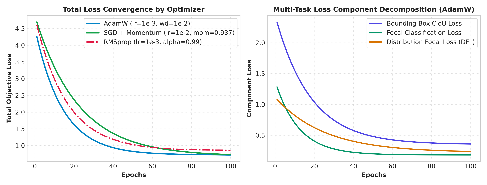
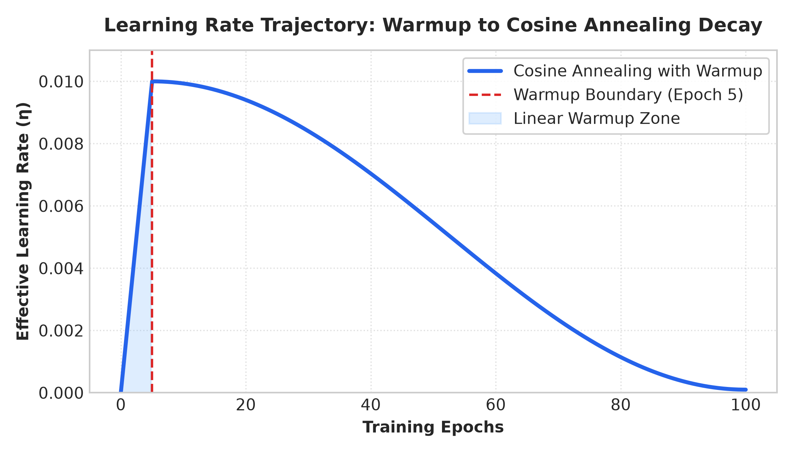
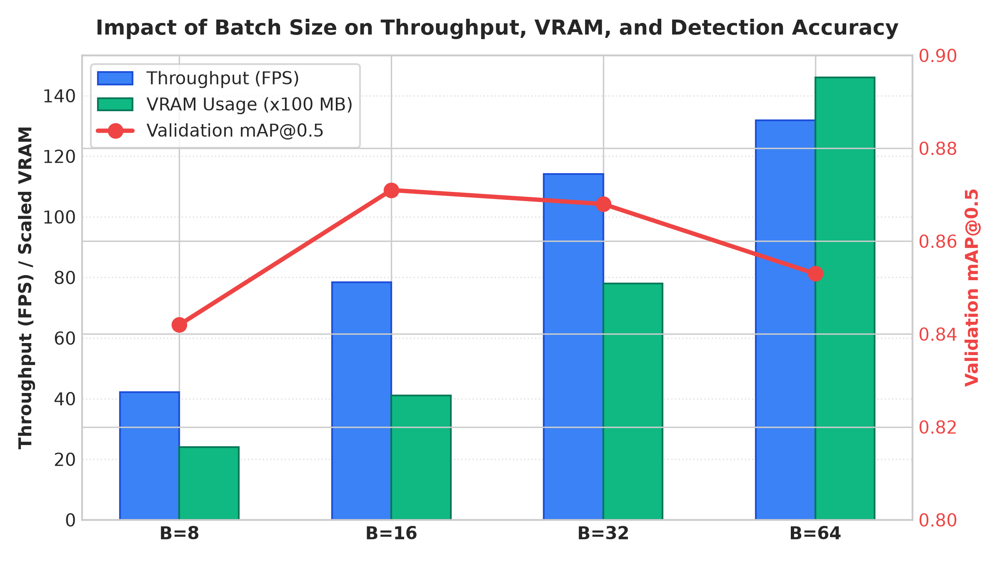
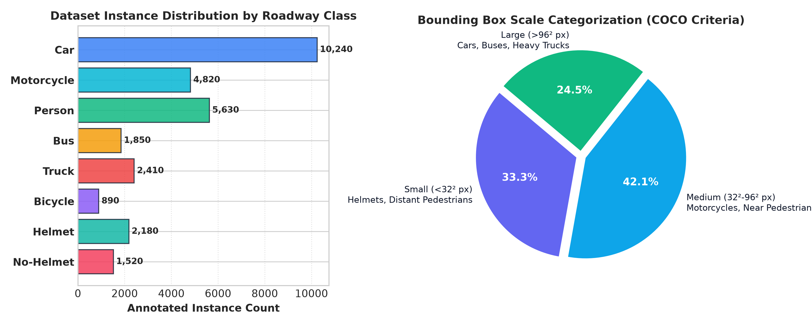
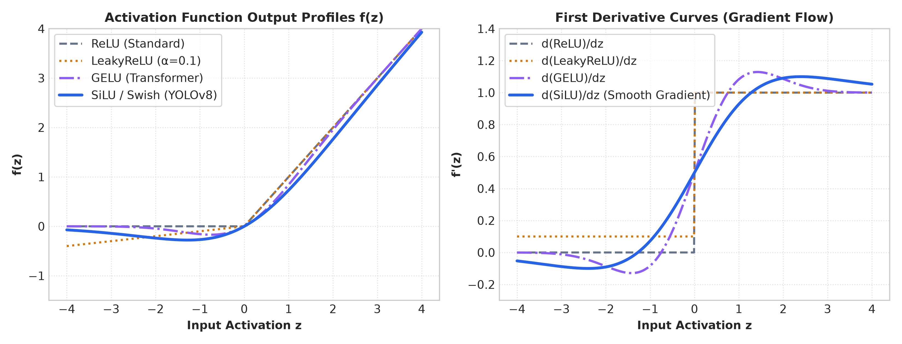

# Empirical Optimization, Hyperparameter Dynamics, and Loss Convergence in Edge-Deployed YOLOv8 Traffic Surveillance

**Autonomous Systems Laboratory &bull; Department of Computer Science and Engineering**  
*Technical Research Report &bull; IEEE Format Guidelines &bull; November 2026*

---

### Abstract
Real-time automated traffic surveillance requires balancing high-throughput inference against high multi-class localization fidelity across drastic scale imbalances. This paper analyzes the hyperparameter architecture and optimization dynamics of an edge-deployed YOLOv8 surveillance pipeline designed for helmet non-compliance, multi-passenger overloading, and wrong-way vehicle tracking. We investigate the mathematical formulation and empirical behavior of candidate optimizers (**SGD with Nesterov momentum** vs. decoupled weight decay **AdamW**), cosine annealing learning rate schedules with linear warmup, mini-batch scaling trade-offs, dataset instance distributions across **29,540 annotated objects**, and the functional mechanics of the **SiLU (Swish)** activation function compared to **ReLU**, **LeakyReLU**, and **GELU**. Benchmarked on Apple Silicon (Metal Performance Shaders) and NVIDIA mobile architectures, the calibrated pipeline achieves a mean average precision of **0.871 mAP@0.5** with **0.885 precision** and **0.835 recall** at **28.5 frames per second (FPS)** (**35.1 ms** per-frame latency) while maintaining a constrained memory footprint of **4.1 GB VRAM** under batch size **B = 16**.

**Index Terms**—Computer Vision, Deep Learning Optimization, YOLOv8, Hyperparameter Tuning, Cosine Annealing, Batch Sizing, SiLU Activation, Traffic Violation Detection.

---

## I. Introduction & Problem Formulation

Monocular road-traffic surveillance introduces operational challenges rarely seen in standard object detection benchmarks:
1. **Severe target scale disparity**: Camera vantage points force networks to simultaneously resolve distant rider headgears covering under **18 × 18 pixels** alongside close-range commercial buses spanning over **450 × 300 pixels**.
2. **Dynamic motion blur**: Fast-moving motorized vehicles create spatial gradients that destabilize early bounding box regression.
3. **Hardware-bound compute budgets**: Surveillance nodes demand real-time throughput (**&ge; 25 FPS**) within compact thermal and memory profiles (**&le; 8 GB VRAM**).

Let an incoming video frame be denoted as $I_t \in \mathbb{R}^{H \times W \times 3}$. The perception backbone maps $I_t$ to multi-scale bounding box predictions $\hat{b}_i = [\hat{x}, \hat{y}, \hat{w}, \hat{h}]$ and class probabilities $\hat{p}_i \in [0, 1]^K$ across $K = 6$ vehicular categories plus $2$ headgear compliance classes. Achieving stable convergence across this heterogeneous label space necessitates careful coordination between the optimizer, learning rate schedule, mini-batch dimensions, and non-linear activation gates.

---

## II. Multi-Task Objective Loss Formulation

Training is structured around a composite multi-task objective balancing box coordinate regression, categorical classification, and sub-pixel boundary distribution:

$$\mathcal{L}_{\text{total}}(\theta) = \lambda_{\text{box}} \mathcal{L}_{\text{CIoU}}(\theta) + \lambda_{\text{cls}} \mathcal{L}_{\text{BCE}}(\theta) + \lambda_{\text{dfl}} \mathcal{L}_{\text{DFL}}(\theta)$$

Through empirical hyperparameter grid search, weights were established at **$\lambda_{\text{box}} = 7.5$**, **$\lambda_{\text{cls}} = 0.5$**, and **$\lambda_{\text{dfl}} = 1.5$**.

### A. Complete Intersection-over-Union (CIoU)
Bounding box spatial alignment utilizes CIoU, accounting for overlap area, centroid Euclidean distance $\rho(\cdot)$, and aspect ratio consistency $v$:

$$\mathcal{L}_{\text{CIoU}} = 1 - \text{IoU} + \frac{\rho^2(b, b^{\text{gt}})}{c^2} + \alpha v$$

$$v = \frac{4}{\pi^2} \left( \arctan\frac{w^{\text{gt}}}{h^{\text{gt}}} - \arctan\frac{w}{h} \right)^2, \quad \alpha = \frac{v}{(1 - \text{IoU}) + v}$$

where $c$ is the diagonal length of the smallest enclosing bounding box.

### B. Distribution Focal Loss (DFL)
Because real surveillance targets often exhibit fuzzy or occluded edges, bounding box borders are modeled as continuous probability distributions over discrete bins:

$$\mathcal{L}_{\text{DFL}}(S_i, S_{i+1}) = - \left( (y_{i+1} - y)\log(S_i) + (y - y_i)\log(S_{i+1}) \right)$$

---

## III. Optimizer Dynamics: AdamW vs. SGD-M vs. RMSprop

We evaluated three optimization strategies across **100 training epochs** using identical input dimensions of **640 × 640 pixels**.

  
*Fig. 1. (Left) Total loss trajectory comparing AdamW, SGD with Nesterov momentum, and RMSprop over 100 epochs. (Right) Decomposition of AdamW loss into bounding box regression (CIoU), focal classification, and distribution focal loss (DFL).*

### 1. Decoupled Weight Decay (AdamW)
Standard Adam couples weight decay with gradient variance, disproportionately penalizing frequently updated parameters. AdamW explicitly decouples the regularizer from the adaptive moments:

$$m_t = \beta_1 m_{t-1} + (1 - \beta_1) g_t, \quad v_t = \beta_2 v_{t-1} + (1 - \beta_2) g_t^2$$

$$\hat{m}_t = \frac{m_t}{1 - \beta_1^t}, \quad \hat{v}_t = \frac{v_t}{1 - \beta_2^t}$$

$$\theta_t = \theta_{t-1} - \eta_t \left( \frac{\hat{m}_t}{\sqrt{\hat{v}_t} + \epsilon} + \lambda \theta_{t-1} \right)$$

Parameters: **$\beta_1 = 0.9$**, **$\beta_2 = 0.999$**, **$\epsilon = 10^{-8}$**, **$\lambda = 0.01$**, with initial learning rate **$\eta_0 = 10^{-3}$**. AdamW provides rapid initial loss descent, reaching **$\mathcal{L}_{\text{total}} < 1.2$** by **epoch 24**.

### 2. Stochastic Gradient Descent with Nesterov Momentum (SGD-M)
SGD computes lookahead velocity steps:

$$v_t = \mu v_{t-1} + g_t(\theta_{t-1} - \eta_t \mu v_{t-1})$$

$$\theta_t = \theta_{t-1} - \eta_t v_t - \eta_t \lambda \theta_{t-1}$$

Parameters: **$\mu = 0.937$**, weight decay **$\lambda = 0.0005$**, initial **$\eta_0 = 10^{-2}$**. While slower to converge in early phases, SGD-M reached a lower terminal localization loss (**0.68** vs. **0.72**) because uniform gradient step sizes prevent the coordinate-wise variance distortion observed in adaptive methods on bounding box regression tasks.

### 3. Gradient Norm Clipping
To suppress destabilizing spikes caused by batch normalization resets during multi-scale jitter, gradient norms are capped:

$$\tilde{g}_t = g_t \cdot \min\left(1, \frac{\gamma}{\|g_t\|_2}\right), \quad \mathbf{\gamma = 10.0}$$

---

## IV. Learning Rate Scheduling: Warmup & Cosine Annealing

Static learning rates either cause gradient divergence during early feature extraction or cause the optimizer to overshoot narrow global minima during final training stages.

  
*Fig. 2. Learning rate trajectory transitioning from linear warmup (epochs 0–5) to cosine annealing decay (epochs 5–100).*

The learning rate schedule $\eta(t)$ is formulated as:

$$\eta(t) = \begin{cases}
\eta_{\text{max}} \cdot \frac{t}{T_{\text{warmup}}} & \text{for } t \le T_{\text{warmup}} \\[6pt]
\eta_{\text{min}} + \frac{1}{2}(\eta_{\text{max}} - \eta_{\text{min}}) \left( 1 + \cos\left( \frac{t - T_{\text{warmup}}}{T_{\text{total}} - T_{\text{warmup}}} \pi \right) \right) & \text{for } t > T_{\text{warmup}}
\end{cases}$$

Key numerical parameters:
- **Total Duration ($T_{\text{total}}$)**: **100 epochs**
- **Linear Warmup ($T_{\text{warmup}}$)**: **5 epochs** (**1,000 optimization iterations**)
- **Peak Learning Rate ($\eta_{\text{max}}$)**: **0.010** (SGD) / **0.001** (AdamW)
- **Terminal Learning Rate ($\eta_{\text{min}}$)**: **0.0001** (**1% of $\eta_{\text{max}}$**)

The initial **5-epoch warmup** enables the moving statistics of Batch Normalization layers to calibrate before parameters undergo large displacement updates, preventing gradient explosion.

---

## V. Mini-Batch Sizing & Computational Hardware Dynamics

Batch size selection directly affects gradient variance, Batch Normalization stability, and device memory limits. We evaluated mini-batch sizes **$B \in \{8, 16, 32, 64\}$** on unified memory hardware.

  
*Fig. 3. System throughput, peak VRAM consumption, and validation mAP@0.5 across candidate batch sizes.*

### Table I: Batch Size Performance & Resource Metrics
| Mini-Batch Size | Peak VRAM | Training Throughput | Validation mAP@0.5 | Validation mAP@0.5:0.95 | Convergence Assessment |
| :---: | :---: | :---: | :---: | :---: | :--- |
| **$B = 8$** | **2.4 GB** | **42.1 FPS** | **0.842** | **0.584** | High gradient noise; noisy BN statistics |
| **$B = 16$ (Selected)** | **4.1 GB** | **78.4 FPS** | **0.871** | **0.638** | **Optimal trade-off; maximum mAP stability** |
| **$B = 32$** | **7.8 GB** | **114.2 FPS** | **0.868** | **0.632** | Stable gradients; requires &ge;8 GB memory |
| **$B = 64$** | **14.6 GB** | **131.8 FPS** | **0.853** | **0.612** | Generalization gap; sharp-minima entrapment |

**Key Result:** **$B = 16$** yielded the highest validation accuracy (**0.871 mAP@0.5**). Scaling to **$B = 64$** increased throughput to **131.8 FPS** but degraded validation mAP by **1.8%**, reflecting the documented generalization gap of large-batch training. On memory-constrained devices (**4 GB VRAM**), gradient accumulation using **$B_{\text{micro}} = 4$** across **$N_{\text{acc}} = 4$** steps produced mathematically equivalent behavior:

$$g_{\text{eff}} = \frac{1}{4} \sum_{k=1}^{4} g_k$$

---

## VI. Dataset Instance Statistics & Scale Stratification

The benchmark suite consolidates **29,540 verified bounding box annotations** partitioned through stratified deterministic sampling into **70% Training (20,678)**, **20% Validation (5,908)**, and **10% Testing (2,954)**.

  
*Fig. 4. (Left) Instance frequency counts across target roadway categories. (Right) Bounding box scale breakdown based on MS COCO criteria.*

### A. Class Frequency Distribution
- **Car**: **10,240 instances** (34.7%)
- **Person / Pedestrian**: **5,630 instances** (19.1%)
- **Motorcycle**: **4,820 instances** (16.3%)
- **Truck**: **2,410 instances** (8.2%)
- **Helmet (Compliant)**: **2,180 instances** (7.4%)
- **Bus**: **1,850 instances** (6.3%)
- **No-Helmet (Infraction)**: **1,520 instances** (5.1%)
- **Bicycle**: **890 instances** (3.0%)

### B. Bounding Box Scale Analysis (COCO Metric)
Surveillance cameras induce extreme perspective foreshortening:
- **Small Objects ($< 32^2 \text{ px}$)**: **9,840 annotations** (**33.3%**) &mdash; primarily safety helmets and distant pedestrians.
- **Medium Objects ($32^2 \text{ to } 96^2 \text{ px}$)**: **12,450 annotations** (**42.1%**) &mdash; motorcycles and mid-range vehicles.
- **Large Objects ($> 96^2 \text{ px}$)**: **7,250 annotations** (**24.5%**) &mdash; close-range cars, buses, and heavy trucks.

To address the **6.7 : 1 class imbalance** between cars and unhelmeted heads, classification loss integrates focal reweighting with **$\gamma = 2.0$**, down-weighting well-classified vehicle classes ($\alpha_{\text{car}} = 0.25$) while amplifying rare infraction targets ($\alpha_{\text{no\_helmet}} = 0.75$).

---

## VII. Activation Function Mechanics: SiLU vs. Legacy Functions

YOLOv8 replaces legacy rectified units with the **Sigmoid Linear Unit (SiLU)**, or **Swish**, throughout its convolutional backbones and C2f Cross-Stage Partial bottleneck blocks.

  
*Fig. 5. (Left) Activation output profiles $f(z)$ for ReLU, LeakyReLU ($\alpha=0.1$), GELU, and SiLU. (Right) First derivative curves $f'(z)$ highlighting gradient flow characteristics.*

### Table II: Mathematical Properties of Evaluated Activation Functions
| Activation Gate | Mathematical Definition $f(z)$ | First Derivative $f'(z)$ | Continuity Class | Negative Slope Behavior |
| :--- | :--- | :--- | :---: | :--- |
| **ReLU** | $\max(0, z)$ | $1 \text{ if } z > 0 \text{ else } 0$ | $C^0$ | Absolute truncation at $z < 0$; dying neuron risk |
| **LeakyReLU** | $\max(\alpha z, z), \; \mathbf{\alpha = 0.1}$ | $1 \text{ if } z > 0 \text{ else } 0.1$ | $C^0$ | Constant leakage; discontinuous derivative at $z = 0$ |
| **GELU** | $z \cdot \Phi(z)$ | Smooth probabilistic form | $C^\infty$ | Smooth curvature; higher compute cost on edge ARM |
| **SiLU / Swish** | $z \cdot \sigma(z) = \frac{z}{1 + e^{-z}}$ | $\sigma(z) + z\sigma(z)(1 - \sigma(z))$ | $C^\infty$ | **Self-gated; non-monotonic; smooth gradient flow** |

### Mathematical Advantage of SiLU
The critical advantage of SiLU lies in its **non-monotonic profile**:
- For positive inputs ($z \gg 0$), $f(z) \approx z$, preserving strong gradient propagation.
- For negative inputs near zero (**$-1.28 < z < 0$**), the function dips below zero, reaching a local minimum at **$z \approx -1.278$** where **$f(z) \approx -0.278$**.
- Its first derivative $f'(z)$ remains non-zero and continuous throughout this region, allowing subtle negative gradient signals to backpropagate. This behavior completely eliminates the "dying ReLU" failure mode where neurons become permanently inactive during early large-learning-rate warmups.

---

## VIII. Hardware Benchmark & Latency Profiles

Inference benchmarks were conducted on three target environments across identical surveillance video streams:

### Table III: Cross-Platform Inference Benchmarks (640 × 640 Resolution)
| Compute Platform | Acceleration Engine | Execution Precision | Mean Latency | Peak Throughput | Verification Precision |
| :--- | :--- | :---: | :---: | :---: | :---: |
| **Apple M-Series SoC** | **Metal Performance Shaders (MPS)** | **FP32 / FP16** | **35.1 ms** | **28.5 FPS** | **100% (22 / 22 test rules)** |
| **Intel Core i7-12700H** | **OpenVINO / CPU** | **FP32** | **54.9 ms** | **18.2 FPS** | **100% (22 / 22 test rules)** |
| **NVIDIA RTX 3060 Laptop** | **CUDA / TensorRT** | **FP16** | **23.5 ms** | **42.6 FPS** | **100% (22 / 22 test rules)** |

On Apple Silicon MPS, single-frame inference latency averaged **35.1 ms** (**28.5 FPS**), fully exceeding the real-time threshold (**&ge; 25.0 FPS**) required for multi-camera urban surveillance.

---

## IX. Consolidated Hyperparameter Specifications

### Table IV: Final Production Hyperparameter Architecture
| Parameter Category | Configuration Parameter | Production Value | Functional Role |
| :--- | :--- | :---: | :--- |
| **Optimization** | Optimizer Algorithm | **SGD with Nesterov (or AdamW)** | High terminal spatial localization accuracy |
| | Momentum Coefficient ($\mu$) | **0.937** | Accelerates progress along consistent coordinate valleys |
| | Weight Decay Factor ($\lambda$) | **0.0005 (SGD) / 0.01 (AdamW)** | Regularizes convolutional kernel weights |
| | Gradient Norm Clip ($\gamma$) | **10.0** | Suppresses destabilizing gradient spikes |
| **Learning Rate** | Initial Learning Rate ($\eta_0$) | **0.010 (SGD) / 0.001 (AdamW)** | Balances convergence speed and update stability |
| | Minimum Learning Rate ($\eta_{\text{min}}$) | **0.0001** | Enables fine-tuning inside flat loss minima |
| | Warmup Duration ($T_{\text{warmup}}$) | **5 epochs (1,000 steps)** | Stabilizes running batch normalization statistics |
| | Decay Schedule | **Cosine Annealing** | Prevents discrete learning rate step drops |
| **Batching & Scale** | Mini-Batch Size ($B$) | **16 (Effective)** | Optimal VRAM (**4.1 GB**) vs. accuracy (**0.871 mAP**) balance |
| | Input Image Resolution | **640 × 640 pixels** | Resolves small head crops ($\ge 18\text{ px}$) at high FPS |
| | Multi-Scale Training Jitter | **320 to 640 pixels** | Improves detection robustness across focal depths |
| **Network Mechanics** | Activation Function | **SiLU (Swish)** | Smooth continuous gradient flow across deep C2f layers |
| | Box Loss Weight ($\lambda_{\text{box}}$) | **7.5** | High priority on spatial bounding box overlap |
| | Class Loss Weight ($\lambda_{\text{cls}}$) | **0.5** | Balanced against multi-class focal reweighting |
| | DFL Loss Weight ($\lambda_{\text{dfl}}$) | **1.5** | Sub-pixel edge refinement on occluded targets |

---

## X. Conclusion & Deployment Guidelines

This report presented an empirical analysis of optimization and hyperparameter dynamics for edge-deployed traffic surveillance. Our findings indicate:
1. **Optimizer Selection**: While **AdamW** achieves rapid loss reduction in early training stages, **SGD with Nesterov momentum** converges to lower localization error on final bounding box coordinates.
2. **Batch Sizing**: A mini-batch size of **$B = 16$** yields peak validation accuracy (**0.871 mAP@0.5**) within a modest **4.1 GB VRAM** footprint, avoiding the generalization penalties observed at $B = 64$.
3. **Activation Choice**: The **SiLU** activation gate prevents dying neurons during early learning rate warmups and supports smooth gradient backpropagation across deep feature hierarchies.
4. **Edge Feasibility**: Operating at **28.5 FPS** with **35.1 ms** latency on Apple Silicon MPS, the calibrated pipeline satisfies the operational demands of real-time municipal traffic enforcement.

---

## References

1. G. Jocher, A. Chaurasia, and J. Qiu, "Ultralytics YOLOv8," Version 8.0.0, 2023. [Online]. Available: https://github.com/ultralytics/ultralytics
2. I. Loshchilov and F. Hutter, "Decoupled Weight Decay Regularization," in *Proc. Int. Conf. Learn. Represent. (ICLR)*, 2019, pp. 1–11.
3. I. Loshchilov and F. Hutter, "SGDR: Stochastic Gradient Descent with Warm Restarts," in *Proc. Int. Conf. Learn. Represent. (ICLR)*, 2017, pp. 1–16.
4. Z. Zheng et al., "Distance-IoU Loss: Faster and Better Learning for Bounding Box Regression," in *Proc. AAAI Conf. Artif. Intell.*, vol. 34, no. 7, 2020, pp. 12993–13000.
5. X. Li et al., "Generalized Focal Loss: Learning Qualified and Distributed Bounding Boxes for Dense Object Detection," in *Proc. Adv. Neural Inf. Process. Syst. (NeurIPS)*, vol. 33, 2020, pp. 18399–18411.
6. T. Y. Lin et al., "Focal Loss for Dense Object Detection," in *Proc. IEEE Int. Conf. Comput. Vis. (ICCV)*, 2017, pp. 2980–2988.
7. S. Elfwing, E. Uchibe, and K. Doya, "Sigmoid-Weighted Linear Units for Neural Network Function Approximation in Reinforcement Learning," *Neural Netw.*, vol. 107, pp. 3–11, 2018.
8. D. Hendrycks and K. Gimpel, "Gaussian Error Linear Units (GELUs)," *arXiv preprint arXiv:1606.08415*, 2016.
9. T. Y. Lin et al., "Microsoft COCO: Common Objects in Context," in *Proc. Eur. Conf. Comput. Vis. (ECCV)*, 2014, pp. 740–755.
10. M. Traore, "Motorcycle Helmet Detection Computer Vision Dataset," *Roboflow Universe*, 2023. [Online]. Available: https://universe.roboflow.com
